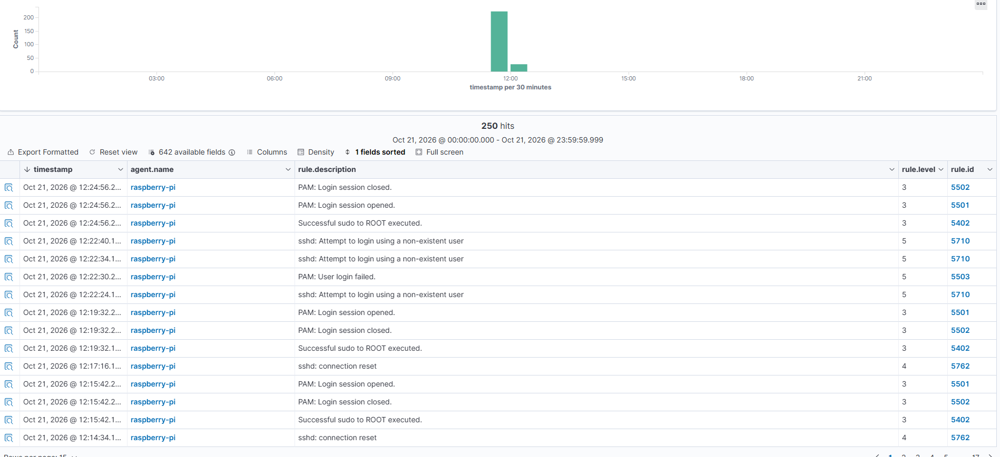

# SSH Authentication Failure Detection

## Objective

Detect and analyze failed SSH authentication attempts using Wazuh SIEM.

## Lab Environment

- SIEM: Wazuh 4.14.9
- SIEM Server: Ubuntu Server 24.04 LTS
- Monitored Endpoint: Raspberry Pi (Debian 13, ARM64)
- Wazuh Agent: 4.14.9
- Test Client: Windows PowerShell

## Test Scenario

A controlled SSH authentication test was performed against the Raspberry Pi using a non-existent username.

```bash
ssh -o PubkeyAuthentication=no -o PreferredAuthentications=password testwazuh@192.168.178.162
```

The authentication attempts were unsuccessful.

## Detection Results

Wazuh successfully generated alerts for the authentication activity.

| Rule ID | Description | Level |
|---|---|---|
| 5710 | SSH login attempt using a non-existent user | 5 |
| 5503 | PAM user login failed | 5 |

Three alerts matching rule 5710 were visible in the Wazuh dashboard.

## Log Analysis

The Raspberry Pi recorded the following events:

- Invalid user `testwazuh`
- PAM authentication failure
- Failed SSH password authentication
- Authentication timeout

The events originated from the test client at `192.168.178.124`.

## Conclusion

The test confirmed that the Wazuh agent successfully forwarded SSH authentication events to the Wazuh Manager.

Wazuh identified the suspicious login attempts and generated security alerts.

This demonstrates basic SSH authentication monitoring and log-based threat detection in a controlled homelab environment.

## Detection Evidence

The following screenshot shows SSH authentication
alerts detected by Wazuh.


